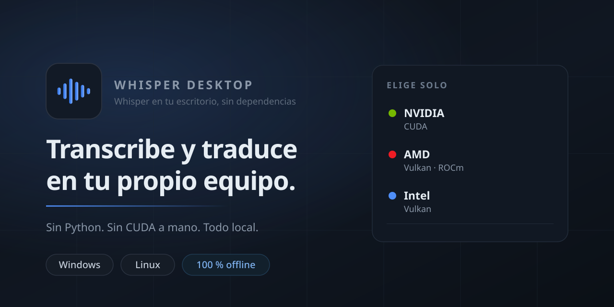

<div align="center">



# Whisper Desktop

**Transcribe y traduce audio a texto en tu PC. Sin internet. Sin Python.**

[](https://github.com/TuxArchi/whisper-desktop/actions/workflows/ci.yml)
[](LICENSE)


**[Sitio web](https://tuxarchi.github.io/whisper-desktop/) · [Releases](https://github.com/TuxArchi/whisper-desktop/releases)**

</div>

Instalador con GUI que detecta tu hardware, elige el mejor backend (CPU, NVIDIA CUDA,
Vulkan o AMD ROCm) y el modelo adecuado, y te deja una app lista para arrastrar un audio
y obtener texto, subtítulos o traducción al inglés.

## Por qué

- **Sin Python, sin entornos virtuales, sin CUDA a mano.**
- **AMD funciona.** Windows usa Vulkan; Linux usa ROCm cuando tu GPU está soportada.
- **100 % local.** Nada sale de tu equipo. La traducción la hace el propio modelo.
- **Verificado de verdad.** Al instalar se ejecuta un benchmark que confirma qué GPU se
  usó y a qué velocidad.

## Instalación

### Windows

Descarga `WhisperDesktop-x.y.z-x64.zip`, extráelo y ejecuta `WhisperDesktop.exe`.
No requiere administrador ni instalación. El runtime de WebView2 ya viene incluido.

> Si Windows muestra "Windows protegió tu PC": clic derecho en el ZIP →
> Propiedades → **Desbloquear**, y vuelve a extraerlo.

### Ubuntu / Debian / Mint / Pop!_OS

Descarga el `.deb` y ábrelo con doble clic. Se abre el centro de software → *Instalar*.

### Fedora / openSUSE

Descarga el `.rpm` y ábrelo con doble clic → *Instalar*.

### Arch / Manjaro

Descarga el `.pkg.tar.zst` y ábrelo con **pamac** u **octopi**.
La receta (`PKGBUILD`) está en [`packaging/aur`](packaging/aur).

### Universal (avanzado)

```bash
chmod +x WhisperDesktop-*.run
./WhisperDesktop-*.run
```

## Qué hace

- Arrastra audios o vídeos (mp3, wav, m4a, flac, ogg, mp4, mkv, mov…) y obtén TXT, SRT,
  VTT o JSON, con timestamps.
- Transcribir, traducir al inglés, o ambas cosas en el mismo trabajo.
- Lotes completos conservando la estructura de carpetas.
- Cola, historial y carpeta de salida configurable.

## Hardware soportado

| GPU | Windows | Linux |
|---|---|---|
| NVIDIA GTX 900+ | CUDA | CUDA |
| AMD RDNA 4 / Ryzen AI | ROCm | ROCm |
| AMD RDNA 1–3, Vega, GCN | Vulkan | Vulkan (ROCm en RDNA 3) |
| Intel Arc / iGPU | Vulkan | Vulkan |
| Solo CPU (AVX2 recomendado) | ✅ | ✅ |

Detalle completo en [`docs/HARDWARE-MATRIX.md`](docs/HARDWARE-MATRIX.md).

## Diagnóstico

Cualquier usuario puede generar un informe sin abrir la GUI:

```bash
whisper-desktop --detect-only
whisper-desktop --detect-only --json > hardware.json
```

Es lo que pedimos en los issues de hardware.

## Compilar

```bash
cargo test --workspace
cargo run -p wd-cli -- --detect-only
```

La GUI (Tauri + React) se añade en la siguiente fase; ver [`docs/BUILDING.md`](docs/BUILDING.md).

## Créditos y licencias

Motor: [whisper.cpp](https://github.com/ggml-org/whisper.cpp) (MIT) ·
Modelos: [OpenAI Whisper](https://github.com/openai/whisper) (MIT) ·
ffmpeg (LGPL, build sin GPL).

Nuestro código: [MIT](LICENSE).
